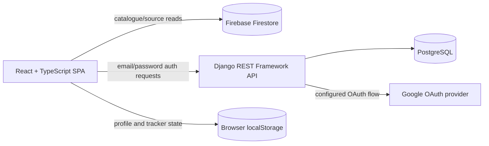

# System Architecture

Last audited: 2026-11-15.

## Current topology

The topology is intentionally split: the browser's catalogue reads use Firestore, while the
Django backend is configured for PostgreSQL and exposes separate catalogue/account APIs. The
audited code does not establish a synchronization path between those catalogue stores.

## Frontend

The client uses React/Vite and route-level pages in `src/pages/` with reusable components in
`src/components/`. Routes are registered in [`src/App.tsx`](../src/App.tsx). Catalogue and
source reads are in [`src/services/databaseService.ts`](../src/services/databaseService.ts);
auth HTTP calls are in [`src/services/authService.ts`](../src/services/authService.ts).
Inspected profile and saved/tracker state is held in [`src/context/AuthContext.tsx`](../src/context/AuthContext.tsx)
and browser storage, rather than synchronized through the corresponding backend APIs.

## Backend and persistence

The backend is Django + Django REST Framework, not the legacy FastAPI architecture described
in older notes. Dependencies are declared in [`backend/requirements.txt`](../backend/requirements.txt);
URL configuration is in [`backend/config/urls.py`](../backend/config/urls.py), settings in
[`backend/config/settings.py`](../backend/config/settings.py), and app models/migrations under
`backend/*/models.py` and `backend/*/migrations/`.

PostgreSQL is configured for Django persistence. Firebase Firestore is a separate client data
store. See [database design](DATABASE_DESIGN.md).

## External services and operational boundaries

- Firebase Auth/Firestore configuration is present for the browser; live project configuration
  and deployed rules were not verified.
- Email/password and Google OAuth API handlers exist in Django; successful live OAuth was not
  verified.
- A production deployment, database, CI result, monitoring service, and backup process were
  not verified. See [deployment readiness](DEPLOYMENT_GUIDE.md).

## Primary evidence

- [`src/App.tsx`](../src/App.tsx)
- [`src/services/databaseService.ts`](../src/services/databaseService.ts)
- [`src/services/authService.ts`](../src/services/authService.ts)
- [`backend/config/urls.py`](../backend/config/urls.py)
- [`backend/config/settings.py`](../backend/config/settings.py)
- [`firestore.rules`](../firestore.rules)
