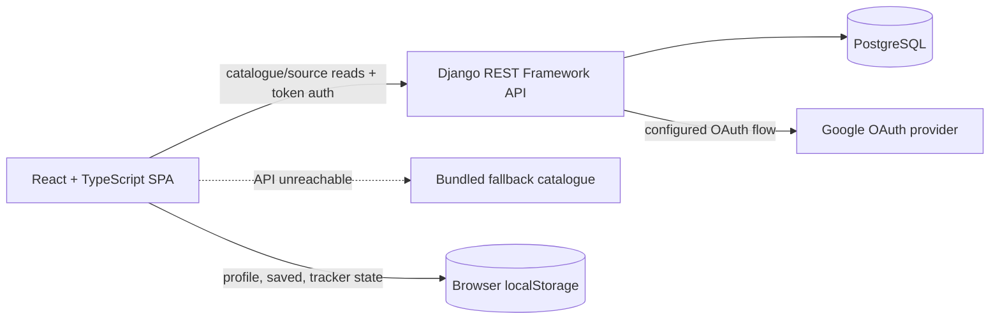

# System Architecture

Last audited: 2026-11-15.

## Current topology



The SPA reaches the API same-origin through the Vite `/api` proxy in development and through
`VITE_API_BASE_URL` elsewhere. Catalogue and source reads go to Django; if the API cannot be
reached, the client falls back to the bundled 48-record catalogue and 10 bundled source
records and labels the result as offline. Empty API results, HTTP errors, and detail 404s are
not converted into static successes. Profile, saved, and tracker state stays in
`localStorage` and is not synchronized with the authenticated APIs.

## Frontend

The client uses React 19/Vite 8 with route-level pages (`src/pages/` and route components) and
reusable components in `src/components/`. Routes are registered in
[`src/App.tsx`](../src/App.tsx) with react-router. Catalogue and source reads, pagination, and
response validation live in [`src/services/catalogueService.ts`](../src/services/catalogueService.ts);
auth HTTP calls and token storage are in [`src/services/authService.ts`](../src/services/authService.ts).
Inspected profile and saved/tracker state is held in
[`src/context/AuthContext.tsx`](../src/context/AuthContext.tsx) and browser storage rather than
the corresponding backend APIs.

The API payload parsers are the trust boundary for catalogue data: records that fail shape
checks are rejected or downgraded to `manual_review`, never rendered as trusted.

## Backend and persistence

The backend is Django 6 + Django REST Framework, not the legacy FastAPI architecture described
in older notes. Dependencies are declared in [`backend/requirements.txt`](../backend/requirements.txt);
URL configuration is in [`backend/config/urls.py`](../backend/config/urls.py), settings in
[`backend/config/settings.py`](../backend/config/settings.py), and app models/migrations under
`backend/*/models.py` and `backend/*/migrations/`. Production serving uses gunicorn, WhiteNoise,
and `dj-database-url`; [`render.yaml`](../render.yaml) describes a Render web service and
PostgreSQL database.

PostgreSQL is the only server-side store. The bundled catalogue is loaded with:

```bash
npx tsx scripts/export-catalogue-bundle.ts   # regenerate fixture from TS source
cd backend && python manage.py seed_catalogue_bundle
```

`backend/main.py`, `backend/models.py`, and `backend/schemas.py` are legacy FastAPI/SQLAlchemy
artifacts and are not imported by the Django project. Detailed schema notes are maintained in
the local-only academic documentation pack rather than this public developer overview.

## External services and operational boundaries

- Email/password and Google OAuth API handlers exist in Django. Google endpoints return 503
  until client credentials are configured; a successful live OAuth flow was not verified.
- The checked-in Render/Neon configuration is not evidence of a running deployment. A
  production database, CI result, monitoring service, and backup process were not verified.
  See [deployment readiness](DEPLOYMENT_GUIDE.md).
- `firestore.rules` remains as a legacy artifact; the unused legacy Firebase web config was
  removed from the current tree. The client has no Firebase SDK dependency.

## Primary evidence

- [`src/App.tsx`](../src/App.tsx)
- [`src/services/catalogueService.ts`](../src/services/catalogueService.ts)
- [`src/services/authService.ts`](../src/services/authService.ts)
- [`src/context/AuthContext.tsx`](../src/context/AuthContext.tsx)
- [`backend/config/urls.py`](../backend/config/urls.py)
- [`backend/config/settings.py`](../backend/config/settings.py)
- [`render.yaml`](../render.yaml)
