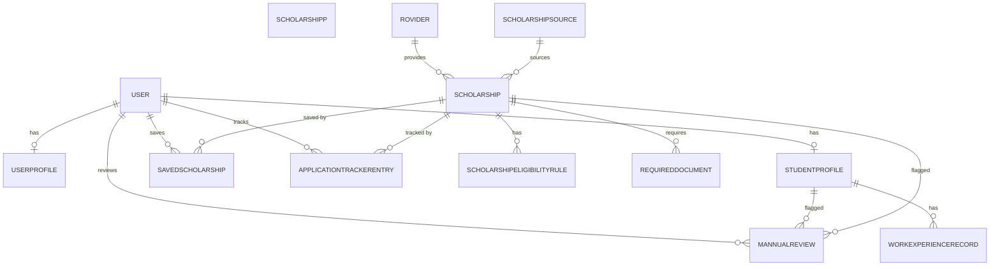

# ER Diagram — ScholarFind

Source of truth: Django models in `backend/*/models.py` and migrations.

## Entities and relationships (Mermaid)

## Relationship explanations

- One User has at most one UserProfile (1:1, PK shared).
- One User has at most one StudentProfile (1:1, PK shared).
- One User can save many scholarships; one Scholarship can be saved by many users (M:N via `SavedScholarship`, unique per pair).
- One User can track many applications; one Scholarship tracked by many users (M:N via `ApplicationTrackerEntry`).
- One Provider can have many Scholarships (1:N).
- One Source can have many Scholarships (1:N).
- One Scholarship has many eligibility rules and required documents (1:N).
- One StudentProfile can have many work experience records and manual review flags (1:N).

## Tables (13)

| Table | PK | Notable FKs |
|---|---|---|
| `auth_user` (Django) | id | — |
| `accounts_userprofile` | user_id (FK→auth_user) | 1:1 |
| `students_studentprofile` | user_id (FK→auth_user) | 1:1 |
| `scholarships_scholarshipprovider` | id | — |
| `scholarships_scholarshipsource` | id | — |
| `scholarships_scholarship` | id | provider_id, source_id |
| `scholarships_scholarshipeligibilityrule` | id | scholarship_id |
| `scholarships_requireddocument` | id | scholarship_id |
| `scholarships_ingestionjob` | id | — |
| `matching_manualreviewflag` | id | student_id, scholarship_id, reviewer_id |
| `matching_workexperiencerecord` | id | student_id |
| `saved_savedscholarship` | id | user_id, scholarship_id (unique pair) |
| `tracking_applicationtrackerentry` | id | user_id, scholarship_id (unique pair) |

## Constraints

- `unique_together`: (user, scholarship) on saved and tracker; (student, scholarship) on manual review.
- `unique`: Scholarship.slug, ScholarshipProvider.name.
- `db_index`: Scholarship.slug, Scholarship.title, Scholarship.application_deadline.
- FK `on_delete=CASCADE` for child rows; `SET_NULL` for reviewer.
- Validators: gpa 0–5, max_gpa 1–5, work_experience >= 0.
