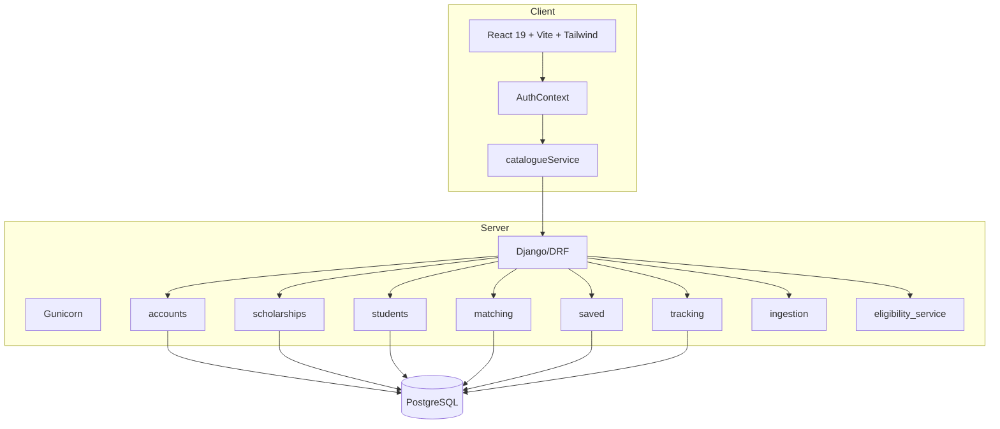
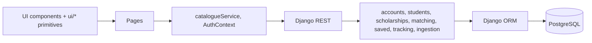
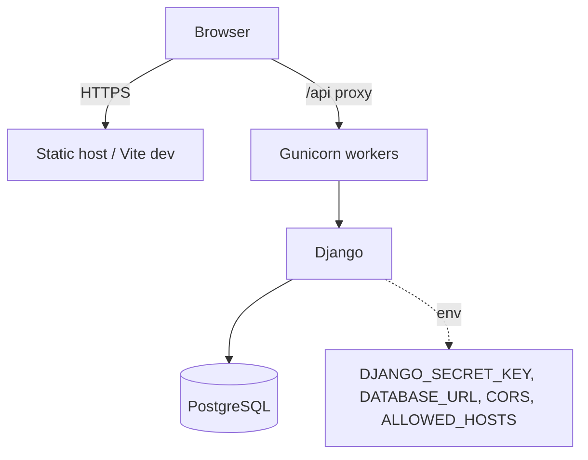
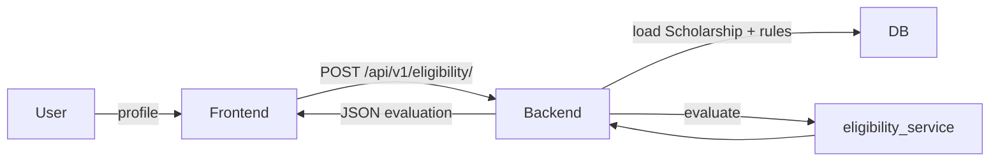
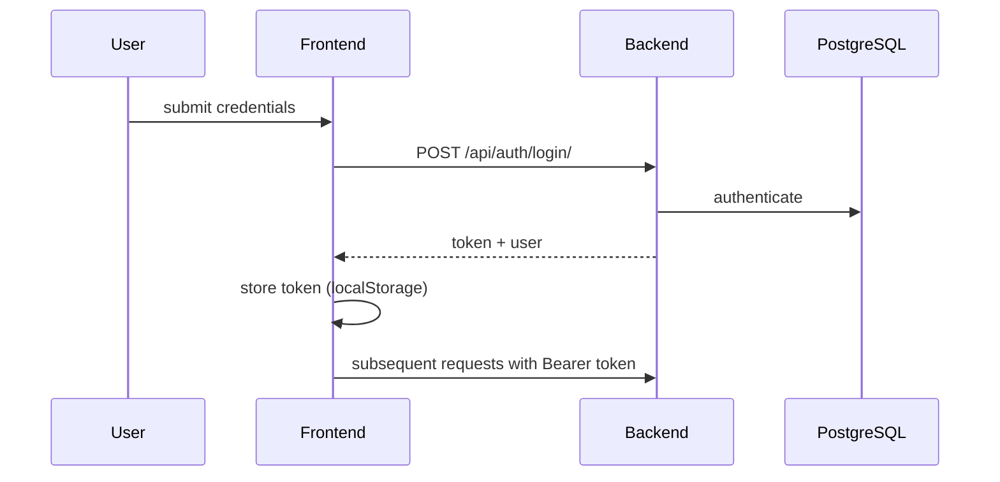
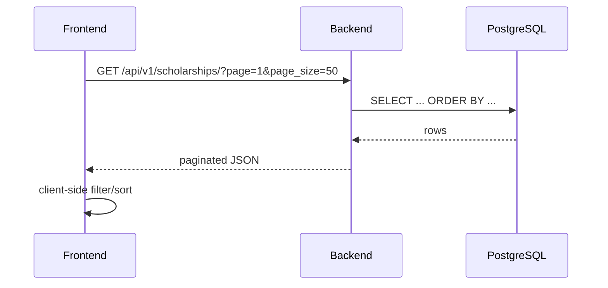
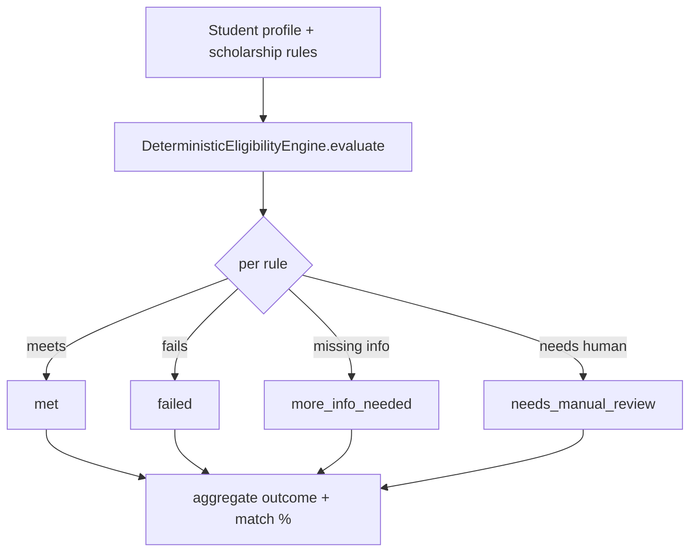

# High-Level Design (HLD) — ScholarFind

## 1. Problem statement

ScholarFind helps Indian students discover scholarships they may be eligible for
and understand why. It aggregates a catalogue of scholarships, applies a
deterministic eligibility engine against a student profile, and links out to
official application pages. It is **not** an official government portal and
does not submit applications on the user's behalf.

**Users:** Indian students (undergraduate → postdoc), and the professor/evaluator
demoing the system.

**Boundaries:** discovery + eligibility explanation + tracking only. No
application submission, no payment, no scraping of live government portals at
request time.

## 2. Functional requirements (as implemented)

- Student registration / login (email+password, Google OAuth)
- Student profile (citizenship/residence pinned to India, academics, tests)
- Scholarship discovery with filters (country, level, field, funding, deadline)
- Scholarship detail page with criteria and official links
- Deterministic eligibility evaluation with per-criterion explanations
- Save / unsave scholarships with status
- Application progress tracking
- Official external redirect gate (OfficialRedirectModal)

Planned / not implemented: email verification, password reset, admin catalogue
editing UI, background ingestion workers, user-scoped profile persistence
end-to-end.

## 3. Non-functional requirements

- Security: DRF token auth, throttling, CSRF for sessions, redirect gate.
- Reliability: offline catalogue fallback in client; health endpoint.
- Maintainability: modular Django apps; shared UI primitives.
- Performance: pagination (page_size), indexes on slug/title/deadline.
- Scalability: stateless API; horizontal via Gunicorn workers (configurable).
- Data integrity: FK constraints, unique constraints, validators.
- Testability: pytest + Playwright suites.

## 4. System architecture

Modular monolith: React SPA ↔ Django/DRF ↔ PostgreSQL.

```
Browser (React SPA)
   │ HTTPS, JSON, Bearer token
   ▼
Django/DRF (Gunicorn)  ──► PostgreSQL
   │
   └── eligibility_service (pure Python, no DB)
```

Why modular monolith: single deployable, shared DB, simple for an academic MVP;
apps split by domain for maintainability without distributed-systems overhead.

## 5. HLD diagrams

### 5.1 System context
```mermaid
flowchart LR
  Student[Student (Browser)] -->|HTTPS| Frontend[React SPA]
  Frontend -->|REST JSON| Backend[Django/DRF API]
  Backend --> DB[(PostgreSQL)]
  Backend --> Google[Google OAuth]
  Backend --> Ext[Official scholarship sites]
  Frontend -.redirect gate.-> Ext
```

### 5.2 Overall architecture


### 5.3 Component diagram


### 5.4 Deployment diagram


### 5.5 Main data flow


### 5.6 Authentication flow


### 5.7 Scholarship discovery flow


### 5.8 Eligibility matching flow

