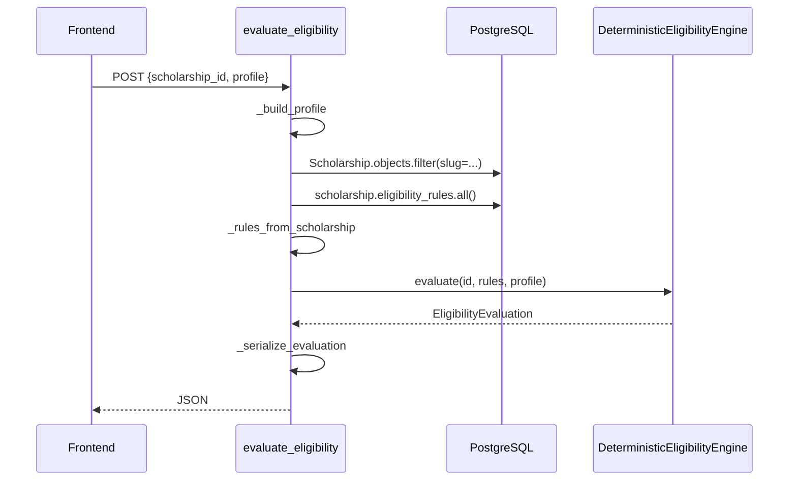
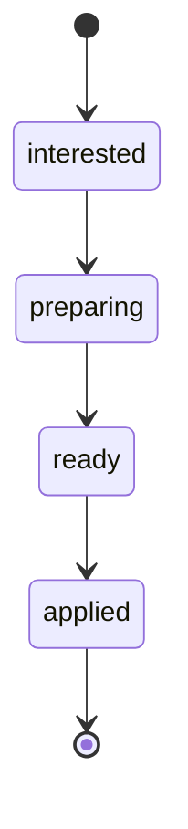

# Low-Level Design (LLD) — ScholarFind

## 1. Backend module structure

Each Django app follows: `models.py`, `serializers.py`, `views.py`, `urls` (via router),
`admin.py`, `migrations/`, `tests.py`.

| Module | Files | Responsibility |
|---|---|---|
| `accounts` | models, serializers, views | Auth (register/login/logout/Google OAuth), `UserProfile`, eligibility endpoints |
| `students` | models, serializers, views | `StudentProfile` CRUD |
| `scholarships` | models, serializers, views, management/commands | Catalogue + rules + documents + ingestion jobs |
| `matching` | models, views | Manual review flags, work experience |
| `saved` | models, views | Saved scholarships with status |
| `tracking` | models, views | Application tracker entries |
| `ingestion` | adapters, pipeline, registry, views | Source adapters + ingestion |
| root | `eligibility.py`, `eligibility_service.py` | Rule dataclasses + deterministic engine |

## 2. Function-level interaction (key flows)

### 2.1 Registration
```
POST /api/auth/register/
  → accounts.views.register
    → RegisterSerializer.is_valid (validate_email, validate_username, validate)
    → RegisterSerializer.create
      → User.objects.create_user
      → UserProfile.objects.create
    → _session_payload → Token.objects.get_or_create
  → Response 201 {token, user}
```

### 2.2 Login
```
POST /api/auth/login/
  → accounts.views.auth_login
    → LoginSerializer.is_valid
    → authenticate(username=identifier)  (fallback: lookup by email)
    → _profile_for_user (get_or_create)
    → _session_payload
```

### 2.3 Scholarship list
```
GET /api/v1/scholarships/?page=&page_size=
  → scholarships.views.ScholarshipViewSet (ModelViewSet, ReadOnly-ish)
    → queryset filter (is_active=True)
    → ScholarshipSerializer (many)
  → paginated Response
```

### 2.4 Eligibility evaluation (DB-aware)
```
POST /api/v1/eligibility/  {scholarship_id, profile, rules?}
  → accounts.views.evaluate_eligibility
    → _build_profile(profile) -> StudentProfileRecord
    → if no rules: Scholarship.objects.filter(slug=...).first()
        → _rules_from_scholarship (reads eligibility_rules)
    → _build_rules(rules_data)
    → DeterministicEligibilityEngine().evaluate(id, rules, profile)
    → _serialize_evaluation
  → Response JSON
```

### 2.5 Save scholarship
```
POST /api/v1/saved-scholarships/
  → saved.views.SavedScholarshipViewSet.perform_create
    → SavedScholarship.objects.create(user=request.user, ...)
```

### 2.6 Application tracker update
```
PATCH /api/v1/application-tracker-entries/{id}/
  → tracking.views.ApplicationTrackerEntryViewSet
    → serializer partial update
```

## 3. API documentation (selected)

| Method | URL | Auth | Purpose |
|---|---|---|---|
| POST | `/api/auth/register/` | none | Create account + token |
| POST | `/api/auth/login/` | none | Login → token |
| POST | `/api/auth/logout/` | token | Revoke token |
| GET | `/api/auth/me/` | token | Current user |
| GET | `/api/v1/health/` | none | Health check |
| GET | `/api/v1/scholarships/` | none | Paginated catalogue |
| GET | `/api/v1/scholarships/{slug}/` | none | Detail |
| POST | `/api/v1/evaluate/` | none (throttled) | FastAPI-compat eval |
| POST | `/api/v1/eligibility/` | none (throttled) | DB-aware eval |
| GET/POST/PATCH/DELETE | `/api/v1/saved-scholarships/` | token | Saved list |
| GET/POST/PATCH/DELETE | `/api/v1/application-tracker-entries/` | token | Tracker |
| GET/POST/PATCH/DELETE | `/api/v1/student-profiles/` | token | Student profile |

## 4. LLD diagrams

### 4.1 Django app/module diagram
```mermaid
flowchart TB
  config[config: settings, urls, wsgi]
  accounts --> students
  accounts --> scholarships
  saved --> scholarships
  tracking --> scholarships
  matching --> students
  matching --> scholarships
  ingestion --> scholarships
  eligibility_service[eligibility_service (root)] -.used by.-> accounts
```

### 4.2 Sequence: eligibility evaluation


### 4.3 State diagram: application tracking

